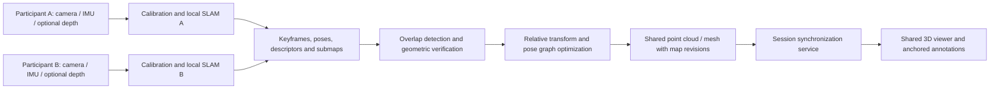

# SpatialSync

### Computer Vision / ML · Collaborative SLAM and Shared 3D Mapping


**Two perspectives. One shared spatial map.**

SpatialSync is a proposed collaborative mapping system that combines observations from two or more mobile or web cameras into a shared 3D representation of an environment. Each participant estimates their camera motion and builds a local map; overlapping observations establish a common coordinate frame, allowing participants to view the same reconstructed scene, camera poses, and spatial annotations.

> **Status: concept and architecture documentation.** This repository currently contains a project proposal and original concept illustration. Camera capture, SLAM, map merging, networking, trained models, and an executable application are not implemented. The illustration is not a product screenshot or measured reconstruction.

## Project classification: ML or DL?

**Primary category: Computer Vision / Robotics (SLAM). Optional category: Machine Learning, including Deep Learning.** SLAM means simultaneous localization and mapping. A geometric baseline can use feature matching, triangulation, optimization, and sensor fusion without training a neural network. LiDAR is a sensing technology, not an ML model.

| Component | Classification | Intended role |
| --- | --- | --- |
| Visual / visual-inertial SLAM | Geometric computer vision | Camera motion, landmarks, loop closure |
| LiDAR / RGB-D fusion | Geometry and sensor fusion | Depth-backed point clouds and metric reconstruction |
| Learned depth, matching, place recognition | Optional DL | Improve camera-only reconstruction or correspondence |
| Semantic segmentation | Optional DL | Label surfaces and mask moving objects |
| Live map synchronization | Distributed systems | Share map revisions, poses, and annotations |

This is **not inherently a generative AI project**. The repository name `CV-ML-SpatialSync` communicates the core field and planned ML extensions without claiming that a deep learning model already exists.

## Vision and inspiration

The idea is inspired by the general concept of connected AR wearables sharing environmental awareness, as described by the project author. SpatialSync is an independent concept with no affiliation with, access to, or claim to reproduce Anduril technology. Initial applications include collaborative room scanning, facility inspection, shared AR annotations, and research into multi-user spatial computing.

The long-term goal is broad environment coverage. Reliable reconstruction of **any environment** is not guaranteed: lighting, texture, motion, reflections, sensor range, and overlap all affect results.

## What users would do

1. Create a mapping session and invite a second participant.
2. Start recording with a calibrated camera; capture timestamped IMU and depth where available.
3. Scan a common static area or shared reference marker to establish alignment.
4. Walk through different parts of the space while local maps grow.
5. Merge geometrically verified overlapping submaps into a shared coordinate system.
6. Inspect a shared point cloud or mesh, participant poses, map age, and annotation anchors.
7. Export a versioned map and replay the capture for evaluation.

Two offline recordings can also be merged after capture if their observations overlap or an external spatial reference is available. They do not need identical start times to align static geometry. Live collaboration additionally requires transport, clock handling, ordering, and revision control.

## Camera, depth, and LiDAR support

| Capture mode | Available information | Main constraint |
| --- | --- | --- |
| Ordinary webcam / monocular video | RGB frames and visual correspondences | Absolute scale is ambiguous without a metric reference; dense depth needs extra reconstruction |
| Mobile RGB + IMU | Images and inertial measurements | Requires calibration and adequate motion; browser sensor access varies |
| Stereo / RGB-D camera | Images plus baseline or measured depth | Device calibration, synchronization, and depth validity matter |
| LiDAR-capable mobile device | Camera, inertial tracking, supported depth APIs | Requires actual LiDAR hardware and a compatible native capture path |

A normal camera does not become LiDAR through software. Learned monocular depth is an estimate and must not be presented as a measured LiDAR return. Browser capture is a useful RGB entry point, but uniform access to native SLAM poses, LiDAR, and synchronized IMU cannot be assumed.

## Proposed architecture



### Reconstruction and map alignment

- Calibrate camera intrinsics, distortion, camera-to-IMU / depth extrinsics, and sensor time offsets.
- Estimate each device trajectory and retain keyframes, descriptors, depth confidence, and local submaps.
- Find candidate overlap using visual retrieval, common markers, or a coarse external reference. A retrieval match alone is insufficient to merge maps.
- Verify correspondences with robust geometry. Estimate an SE(3) transform for consistent metric maps, or Sim(3) when monocular scale must also be resolved.
- Refine a suitable initial alignment with point-cloud registration; ICP alone is vulnerable to poor initialization and repetitive structures.
- Optimize cross-device constraints and loop closures. Reject inconsistent matches instead of forcing unrelated spaces together.
- Fuse accepted observations into voxelized point clouds or a depth-backed surface representation. Track source, confidence, and observation time.

If `T_shared_local` maps a local coordinate frame into the shared frame, then `p_shared = T_shared_local * p_local` for homogeneous metric points. Scale-ambiguous maps require a similarity transform or a known scale reference before metric fusion. Shared anchors must refer to a map revision so optimization corrections can move the scene and annotations consistently.

### Synchronization and scene state

The intended design separates relatively persistent geometry from fast pose updates and time-varying objects. Old observations should not imply that a moving object is still present.

| Message | Proposed payload |
| --- | --- |
| Session / calibration | Session and device IDs, schema version, intrinsics, units, coordinate convention |
| Pose | Sequence number, capture timestamp, local pose, tracking quality, map revision |
| Keyframe / submap | Immutable ID, source device, descriptors or depth reference, bounds, confidence |
| Alignment update | Parent revision, new revision, transforms, accepted constraints |
| Annotation | Anchor ID, map revision, author, geometry, update version |

Use a session coordinator as the initial authority for shared map revisions. Estimate clock offset and drift, preserve capture and receipt times, and deduplicate messages by device and sequence. Send compressed incremental submaps rather than repeatedly broadcasting the entire cloud. Prioritize pose updates, apply backpressure, and support snapshot-plus-delta recovery after reconnects. Network synchronization does not by itself solve spatial alignment.

## Implementation options to evaluate

These are candidates, not installed dependencies or completed integrations:

- **Capture:** native mobile capture for depth and sensor timestamps; browser RGB capture for a constrained camera-only mode.
- **Local SLAM:** evaluate a visual / visual-inertial backend against required platforms and licensing. ORB-SLAM3 is one research baseline; its multi-map capability is not a ready-made distributed collaboration service.
- **Geometry processing:** evaluate Open3D for filtering, registration, and offline reconstruction experiments.
- **Session service:** a reliable control channel with binary incremental geometry transport and persistent map snapshots.
- **Viewer:** a browser 3D renderer with point-cloud level of detail, shared transforms, confidence, and tracking-state indicators.
- **Optional DL:** compare learned depth or segmentation against a geometric baseline before adding model training or inference costs.

Third-party code, model weights, datasets, and mobile SDKs retain their own licenses. Review redistribution obligations before selecting a production stack; this repository does not vendor those dependencies.

## Phased roadmap and acceptance criteria

| Phase | Deliverable | Evidence required |
| --- | --- | --- |
| 1. Single capture | Timestamped RGB / optional depth recording and replay | Calibration metadata and a reproducible capture |
| 2. Local reconstruction | One device produces a map and trajectory | Reconstruction and trajectory evaluation on reference data |
| 3. Offline two-user merge | Align overlapping recordings | Report alignment error and rejected non-overlap cases |
| 4. Live session | Two users exchange poses and map deltas | Both viewers converge on the same revision after reconnect |
| 5. Shared AR | Stable common annotations | Measure anchor drift after loop closure and relocalization |
| 6. Optional DL | Depth / semantic enhancement | Ablation against baseline with runtime and accuracy costs |

Start with a static, textured indoor room, overlapping scans, and two calibrated devices on a local network. Establish offline merging before attempting live dense fusion. No latency, accuracy, or device-coverage results have been measured yet.

## Evaluation plan

Record trajectory error (ATE / RPE where reference poses exist), cross-map alignment error, reconstruction accuracy and completeness, relocalization success, false merge rate, and anchor drift. Measure end-to-end capture-to-display latency using p50 / p95, bandwidth, dropped updates, memory, device temperature, and recovery time. Report hardware, environment, dataset split, units, alignment procedure, and failure cases alongside every result.

Test low texture, fast motion, repeated corridors, moving people, glass, changing illumination, little overlap, delayed packets, and disconnected clients. Reserve distinct environments for evaluating any learned component; adjacent frames from the same recording must not leak across train and test splits.

## Limitations and responsible capture

SLAM can drift or lose tracking. Incorrect loop closures can corrupt a map. Monocular video may not recover reliable metric scale, and different rooms with similar features can produce false matches. Dense reconstruction increases compute, battery, and network demand. Capture only spaces and people you have permission to record; provide session access control, encrypted transport, retention settings, and removal of sensitive imagery in an eventual implementation. This concept is not validated for safety-critical navigation or operational decisions.

## Repository contents and getting started

```text
README.md                              Project proposal and technical plan
docs/images/spatialsync-concept.svg     Original illustrative project artwork
.gitignore                             Excludes secrets and raw capture data
```

There is no application to install or run yet. To begin implementation, first agree on a capture platform, sensor availability, and reference dataset; then implement Phase 1 and retain a reproducible offline baseline. Contributions should state assumptions, include reproducible evidence, and distinguish planned capabilities from demonstrated ones.

## Technical references

- [ORB-SLAM3 official repository](https://github.com/UZ-SLAMLab/ORB_SLAM3): visual, visual-inertial, and multi-map SLAM baseline and licensing information.
- [ORB-SLAM3 paper](https://arxiv.org/abs/2007.11898): underlying research.
- [Apple: Creating a collaborative session](https://developer.apple.com/documentation/arkit/creating-a-collaborative-session): native collaboration data exchange.
- [Apple: Visualizing and interacting with a reconstructed scene](https://developer.apple.com/documentation/arkit/visualizing-and-interacting-with-a-reconstructed-scene): LiDAR-supported scene reconstruction.
- [Open3D: Global registration](https://www.open3d.org/docs/release/tutorial/pipelines/global_registration.html): coarse registration before local refinement.

---

**SpatialSync — a proposed shared spatial understanding layer for collaborative 3D mapping.**
