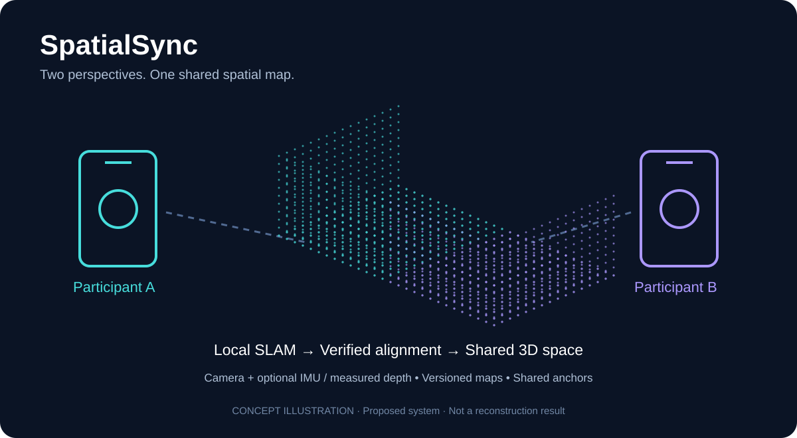
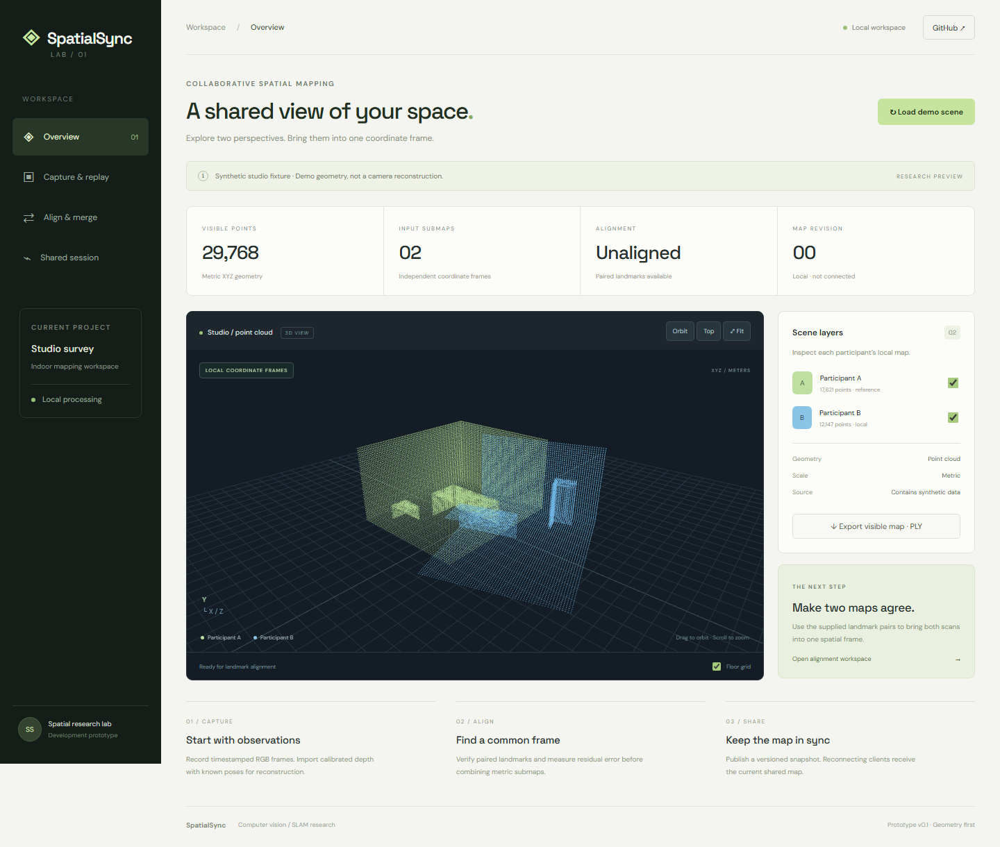
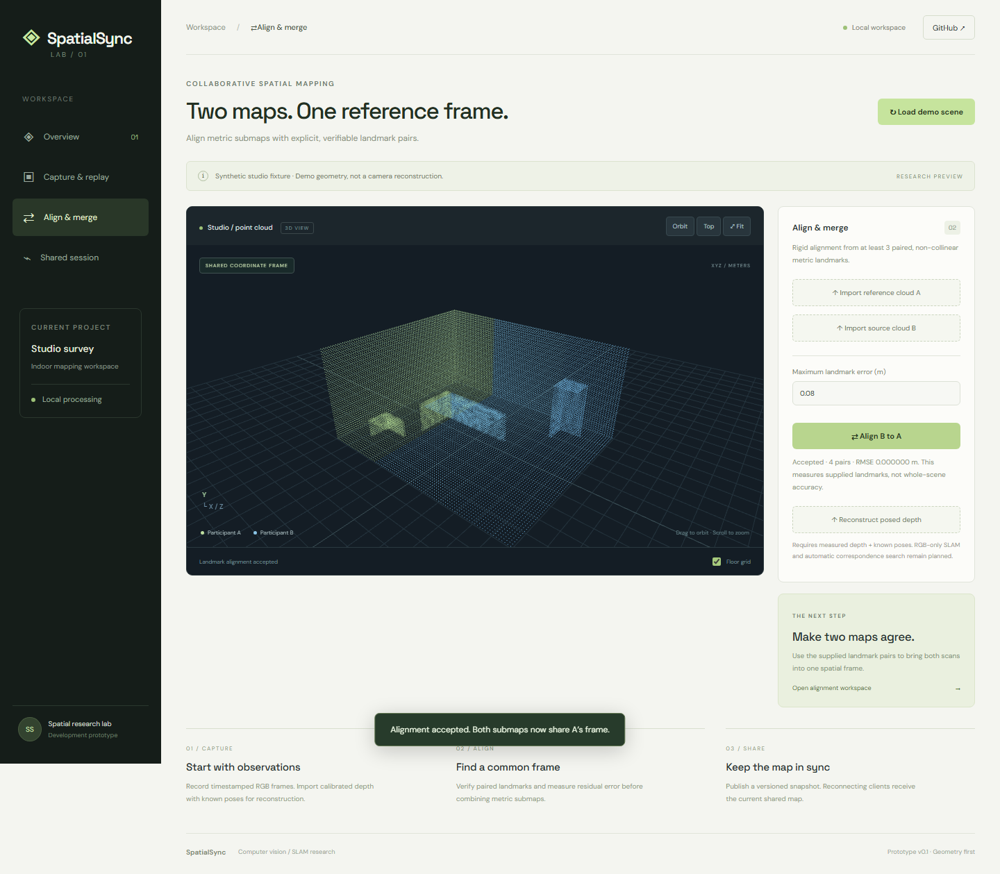
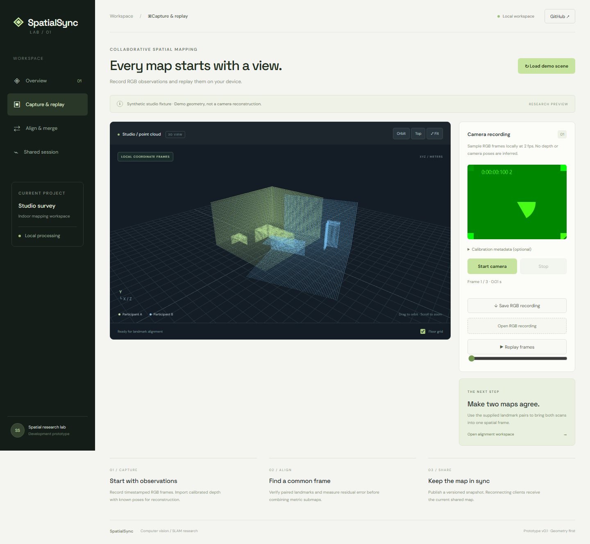
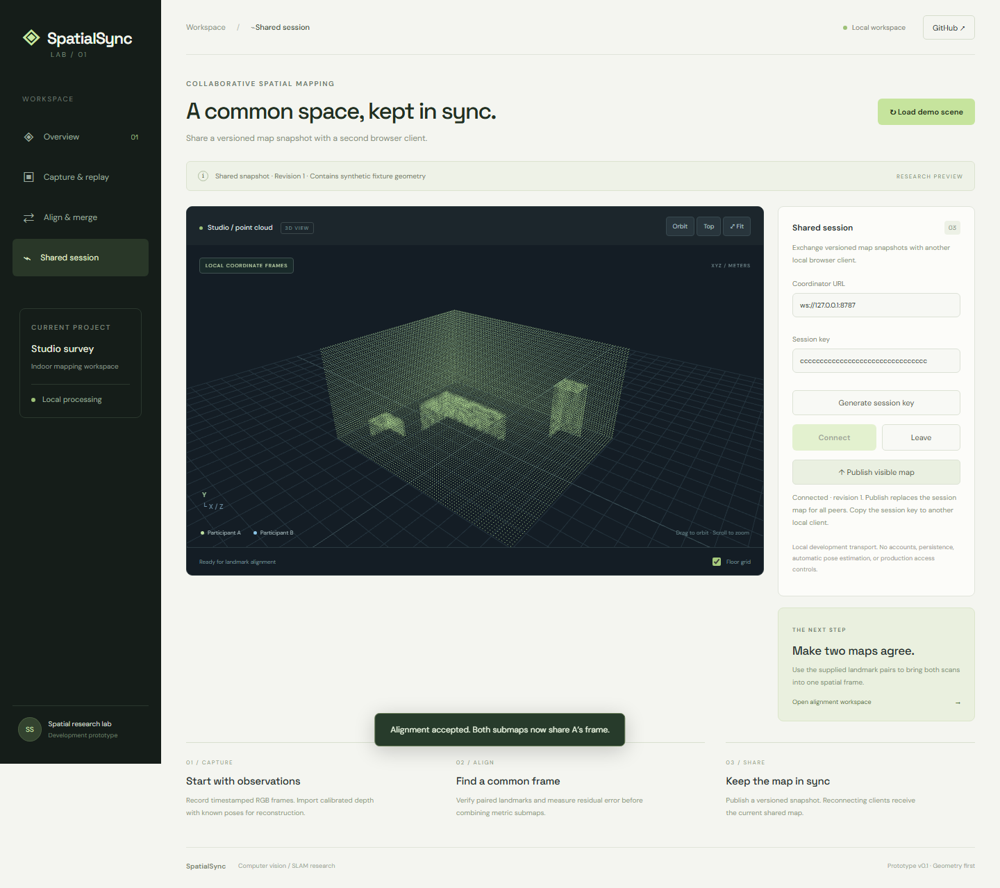
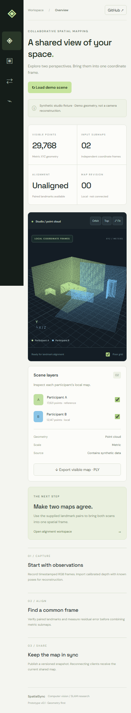
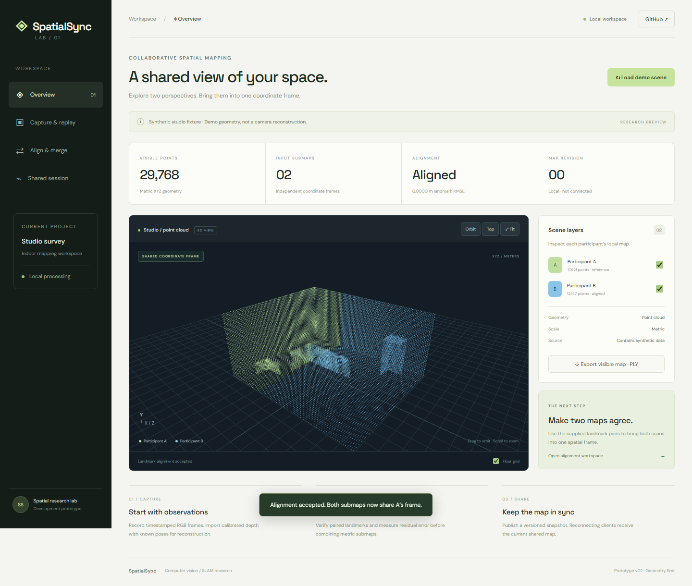
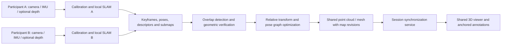

# SpatialSync

### Computer Vision / ML · Collaborative SLAM and Shared 3D Mapping



**Two perspectives. One shared spatial map.**

SpatialSync is a proposed collaborative mapping system that combines observations from two or more mobile or web cameras into a shared 3D representation of an environment. Each participant estimates their camera motion and builds a local map; overlapping observations establish a common coordinate frame, allowing participants to view the same reconstructed scene, camera poses, and spatial annotations.

> **Status: working research prototype v0.1.** Browser RGB sampling/replay, a 3D point-cloud viewer, posed-depth reconstruction, landmark-based rigid alignment, PLY export, and a local shared-map coordinator are implemented. RGB-only SLAM, automatic feature correspondence, native LiDAR capture, continuous pose streaming, shared AR anchors, and trained models remain planned. The initial scene is a clearly labeled synthetic fixture.

## Run the prototype

**[Open the live HTTPS demo](https://vams2krish.github.io/CV-ML-SpatialSync/)**

The public demo serves the production frontend build through GitHub Pages. Viewer, alignment, posed-depth import, RGB capture/replay, and PLY export run in the browser. The optional coordinator still runs locally; the public demo does not provide a hosted shared-session backend. Use the local app for the two-client session workflow.

Requires **Node.js 22.12+** (Node.js 24 used for validation) and a browser with WebGL.

```sh
npm ci
npm run dev
```

Open the localhost URL printed by Vite. In a second terminal, start the optional map coordinator:

```sh
npm run sync
```

Camera access requires localhost or HTTPS and explicit browser permission. The development servers bind to loopback. A phone opening your computer's HTTP LAN address will not automatically have camera access; a trusted HTTPS setup and a deliberate network configuration are needed for physical multi-device testing. The current shared-session smoke test uses two local browser clients.

### Try the working flows

1. **Overview:** orbit the synthetic studio point clouds, toggle layers, use Top / Fit, and export visible points as ASCII PLY.
2. **Align & merge:** select **Align B to A**. The fixture has four exact landmark pairs; the algorithm estimates a rigid transform and reports landmark RMSE. Import your own metric A/B JSON clouds with paired `landmarks` to use other data.
3. **Capture & replay:** start the camera, stop recording, scrub or replay frames, and save / reopen the RGB JSON recording. Frames stay in browser memory until downloaded. No camera data is sent to the coordinator.
4. **Posed depth:** import `examples/posed-depth.json` in Align & merge. This synthetic fixture exercises depth unprojection and voxel filtering with known camera-to-world poses. It does not estimate camera motion.
5. **Shared session:** run the coordinator, generate a session key, and connect. Open a second browser tab at the app URL, paste the same key, and connect. Publishing sends the visible voxel-filtered cloud to both clients and advances the map revision. Reconnecting receives the current snapshot.

## Product showcases

These are screenshots of the running application, captured by the reproducible browser tests. The studio clouds are **synthetic test geometry**, not evidence of real-world SLAM accuracy. The capture showcase uses **Chromium's simulated test camera**, not a recorded physical environment.

### 1. Mapping workspace



### 2. Landmark alignment



### 3. Camera capture and replay



### 4. Shared map session



### 5. Responsive mobile layout



The mobile screenshot is a browser viewport check; physical phone sensors and performance have not been validated.

### 6. Live HTTPS deployment



Captured from the [public live demo](https://vams2krish.github.io/CV-ML-SpatialSync/), not the local development server. The [machine-readable live verification record](docs/live-verification.json) records the tested URL, time, checks, and limitations.

## Project classification: ML or DL?

**Primary category: Computer Vision / Robotics (SLAM). Optional category: Machine Learning, including Deep Learning.** SLAM means simultaneous localization and mapping. A geometric baseline can use feature matching, triangulation, optimization, and sensor fusion without training a neural network. LiDAR is a sensing technology, not an ML model.

| Component | Classification | Intended role |
| --- | --- | --- |
| Visual / visual-inertial SLAM | Geometric computer vision | Camera motion, landmarks, loop closure |
| LiDAR / RGB-D fusion | Geometry and sensor fusion | Depth-backed point clouds and metric reconstruction |
| Learned depth, matching, place recognition | Optional DL | Improve camera-only reconstruction or correspondence |
| Semantic segmentation | Optional DL | Label surfaces and mask moving objects |
| Live map synchronization | Distributed systems | Share map revisions, poses, and annotations |

This is **not inherently a generative AI project**. The current implementation uses geometric computer vision and distributed systems without a trained model. The repository name `CV-ML-SpatialSync` communicates the core field and planned ML extensions without claiming that a deep learning model already exists.

## Vision and inspiration

The idea is inspired by the general concept of connected AR wearables sharing environmental awareness, as described by the project author. SpatialSync is an independent concept with no affiliation with, access to, or claim to reproduce Anduril technology. Initial applications include collaborative room scanning, facility inspection, shared AR annotations, and research into multi-user spatial computing.

The long-term goal is broad environment coverage. Reliable reconstruction of **any environment** is not guaranteed: lighting, texture, motion, reflections, sensor range, and overlap all affect results.

## What users would do

1. Create a mapping session and invite a second participant.
2. Start recording with a calibrated camera; capture timestamped IMU and depth where available.
3. Scan a common static area or shared reference marker to establish alignment.
4. Walk through different parts of the space while local maps grow.
5. Merge geometrically verified overlapping submaps into a shared coordinate system.
6. Inspect a shared point cloud or mesh, participant poses, map age, and annotation anchors.
7. Export a versioned map and replay the capture for evaluation.

Two offline recordings can also be merged after capture if their observations overlap or an external spatial reference is available. They do not need identical start times to align static geometry. Live collaboration additionally requires transport, clock handling, ordering, and revision control.

## Camera, depth, and LiDAR support

| Capture mode | Available information | Main constraint |
| --- | --- | --- |
| Ordinary webcam / monocular video | RGB frames and visual correspondences | Absolute scale is ambiguous without a metric reference; dense depth needs extra reconstruction |
| Mobile RGB + IMU | Images and inertial measurements | Requires calibration and adequate motion; browser sensor access varies |
| Stereo / RGB-D camera | Images plus baseline or measured depth | Device calibration, synchronization, and depth validity matter |
| LiDAR-capable mobile device | Camera, inertial tracking, supported depth APIs | Requires actual LiDAR hardware and a compatible native capture path |

A normal camera does not become LiDAR through software. Learned monocular depth is an estimate and must not be presented as a measured LiDAR return. Browser capture is a useful RGB entry point, but uniform access to native SLAM poses, LiDAR, and synchronized IMU cannot be assumed.

## Proposed architecture



### Reconstruction and map alignment

- Calibrate camera intrinsics, distortion, camera-to-IMU / depth extrinsics, and sensor time offsets.
- Estimate each device trajectory and retain keyframes, descriptors, depth confidence, and local submaps.
- Find candidate overlap using visual retrieval, common markers, or a coarse external reference. A retrieval match alone is insufficient to merge maps.
- Verify correspondences with robust geometry. Estimate an SE(3) transform for consistent metric maps, or Sim(3) when monocular scale must also be resolved.
- Refine a suitable initial alignment with point-cloud registration; ICP alone is vulnerable to poor initialization and repetitive structures.
- Optimize cross-device constraints and loop closures. Reject inconsistent matches instead of forcing unrelated spaces together.
- Fuse accepted observations into voxelized point clouds or a depth-backed surface representation. Track source, confidence, and observation time.

If `T_shared_local` maps a local coordinate frame into the shared frame, then `p_shared = T_shared_local * p_local` for homogeneous metric points. Scale-ambiguous maps require a similarity transform or a known scale reference before metric fusion. Shared anchors must refer to a map revision so optimization corrections can move the scene and annotations consistently.

### Synchronization and scene state

The intended design separates relatively persistent geometry from fast pose updates and time-varying objects. Old observations should not imply that a moving object is still present.

| Message | Proposed payload |
| --- | --- |
| Session / calibration | Session and device IDs, schema version, intrinsics, units, coordinate convention |
| Pose | Sequence number, capture timestamp, local pose, tracking quality, map revision |
| Keyframe / submap | Immutable ID, source device, descriptors or depth reference, bounds, confidence |
| Alignment update | Parent revision, new revision, transforms, accepted constraints |
| Annotation | Anchor ID, map revision, author, geometry, update version |

Use a session coordinator as the initial authority for shared map revisions. Estimate clock offset and drift, preserve capture and receipt times, and deduplicate messages by device and sequence. Send compressed incremental submaps rather than repeatedly broadcasting the entire cloud. Prioritize pose updates, apply backpressure, and support snapshot-plus-delta recovery after reconnects. Network synchronization does not by itself solve spatial alignment.

## Implementation options to evaluate

The implemented prototype uses vanilla JavaScript, Vite, Three.js, ml-matrix (SVD), and a Node.js / WebSocket coordinator. The following remain future integration candidates:

- **Capture:** native mobile capture for depth and sensor timestamps; browser RGB capture for a constrained camera-only mode.
- **Local SLAM:** evaluate a visual / visual-inertial backend against required platforms and licensing. ORB-SLAM3 is one research baseline; its multi-map capability is not a ready-made distributed collaboration service.
- **Geometry processing:** evaluate Open3D for filtering, registration, and offline reconstruction experiments.
- **Session service:** a reliable control channel with binary incremental geometry transport and persistent map snapshots.
- **Viewer:** a browser 3D renderer with point-cloud level of detail, shared transforms, confidence, and tracking-state indicators.
- **Optional DL:** compare learned depth or segmentation against a geometric baseline before adding model training or inference costs.

Third-party code, model weights, datasets, and mobile SDKs retain their own licenses. Review redistribution obligations before selecting a production stack; this repository does not vendor those dependencies.

## Phased roadmap and acceptance criteria

| Phase | Implemented in v0.1 | Remaining acceptance work |
| --- | --- | --- |
| 1. Single capture | Local sampled RGB frames, relative sampling timestamps, optional manual intrinsics, save/import/replay | Native sensor exposure timestamps, calibration procedure, IMU and measured depth capture |
| 2. Local reconstruction | Depth unprojection from supplied poses, voxel centroids, 3D viewer, PLY export | Actual visual / visual-inertial SLAM and real reference-trajectory evaluation |
| 3. Offline two-user merge | SE(3) Kabsch alignment from paired metric landmarks, residual threshold and degeneracy rejection | Automatic matching, outlier-robust estimation, Sim(3), ICP refinement and real overlap evaluation |
| 4. Live session | Two-browser full-map snapshot synchronization, monotonic revisions, stale-write rejection and reconnect recovery | Pose streaming, compressed submap deltas, clock offset estimation, persistence and production authentication |
| 5. Shared AR | Not implemented | Native rendering and revision-aware anchors with measured drift |
| 6. Optional DL | Not implemented | Model selection, baselines, accuracy / runtime evaluation |

The numerical tests verify known synthetic transformations, depth unprojection, failure rejection, voxel centroids, and snapshot convergence. They do not establish real-world reconstruction accuracy. No real-scene SLAM, end-to-end latency, physical phone, or LiDAR results have been measured yet.

## Evaluation plan

Record trajectory error (ATE / RPE where reference poses exist), cross-map alignment error, reconstruction accuracy and completeness, relocalization success, false merge rate, and anchor drift. Measure end-to-end capture-to-display latency using p50 / p95, bandwidth, dropped updates, memory, device temperature, and recovery time. Report hardware, environment, dataset split, units, alignment procedure, and failure cases alongside every result.

Test low texture, fast motion, repeated corridors, moving people, glass, changing illumination, little overlap, delayed packets, and disconnected clients. Reserve distinct environments for evaluating any learned component; adjacent frames from the same recording must not leak across train and test splits.

## Limitations and responsible capture

SLAM can drift or lose tracking. Incorrect loop closures can corrupt a map. Monocular video may not recover reliable metric scale, and different rooms with similar features can produce false matches. Dense reconstruction increases compute, battery, and network demand. Capture only spaces and people you have permission to record; provide session access control, encrypted transport, retention settings, and removal of sensitive imagery in an eventual implementation. This concept is not validated for safety-critical navigation or operational decisions.

## Repository contents and getting started

```text
src/main.js                 Workspace UI, imports, replay and session client
src/viewer.js               Three.js point-cloud viewer and orbit controls
src/capture.js              Local sampled RGB capture and recording validation
src/geometry.js             Depth unprojection, Kabsch registration, voxel fusion, PLY
src/demo.js                 Deterministic synthetic studio fixture
server/sync.js              Bounded in-memory development coordinator
examples/                   Synthetic importable geometry fixtures
test/                       Numerical and WebSocket integration tests
e2e/                        Browser flows and README screenshot generation
docs/images/                Product screenshots and concept artwork
.github/workflows/ci.yml     CI unit, integration, build and browser checks
```

### Import formats and coordinate conventions

See [the data format guide](docs/data-formats.md) for complete schemas, limits, depth conventions, timestamps, and calibration expectations. The viewer uses a right-handed world with +Y up. Input point clouds must share metric scale; the alignment solver does not resolve monocular scale. Depth uses camera +X right, +Y down, +Z forward, transformed by a row-major `cameraToWorld` rigid matrix.

### Verification

```sh
npm test
npm run build
npx playwright install chromium
npm run test:e2e
```

The browser suite builds and serves the **production bundle** at port 5198 and launches the coordinator at 8787; keep those ports free. It tests viewer alignment, layer visibility and PLY download; simulated camera recording, export/import and replay; invalid cloud rejection and posed-depth import; two-client publish/reconnect; mobile overflow; and camera denial. It regenerates the five README screenshots. Camera hardware and native sensor APIs are not exercised. Fonts are bundled locally; no external font service is required.

**Verified for this implementation:** six numerical / coordinator integration tests and five production-build browser scenarios passed locally. The public HTTPS smoke test also passed with no browser exceptions or failed requests; it exercised loading the viewer, landmark alignment, PLY download, posed-depth import, and simulated camera capture/replay. These are functional prototype checks, not proof of production readiness or real-world SLAM accuracy.

To repeat the public deployment check and regenerate its screenshot / JSON record:

```sh
node scripts/live-smoke.js
```

GitHub Actions runs [prototype verification](https://github.com/vams2krish/CV-ML-SpatialSync/actions/workflows/ci.yml) and [Pages deployment](https://github.com/vams2krish/CV-ML-SpatialSync/actions/workflows/pages.yml) on pushes to main. The live site is a production frontend build of this **research prototype**; a hosted multi-user backend, production authorization, physical-device validation, and a full SLAM pipeline remain future work.

### Current synchronization limits

The coordinator is a **local development service**, not a hosted collaboration backend. Session keys are random 128-bit values; anyone who knows a key and can access the coordinator can replace that session's map. Browser origins are restricted to localhost / loopback. There are no user identities, durable storage, encrypted `ws://` transport, or per-user access policies. A publish replaces the full shared map, rather than automatically fusing peer observations. Stale writes are rejected and the current snapshot is restored; keep an exported copy of your local work before publishing. Empty sessions expire after ten minutes; a process restart clears all maps.

The prototype intentionally limits RGB capture to 180 JPEG samples (roughly 90 seconds at 2 fps), JSON imports to 30 MB, point clouds to 100,000 finite metric points, and depth imports to 100 frames / one million unprojected samples. These limits keep browser and coordinator memory bounded. Captures have browser sampling timestamps, not hardware frame exposure timestamps; they are not yet a tightly synchronized SLAM dataset.

Contributions should state assumptions, include reproducible evidence, and distinguish planned capabilities from demonstrated ones.

## Technical references

- [ORB-SLAM3 official repository](https://github.com/UZ-SLAMLab/ORB_SLAM3): visual, visual-inertial, and multi-map SLAM baseline and licensing information.
- [ORB-SLAM3 paper](https://arxiv.org/abs/2007.11898): underlying research.
- [Apple: Creating a collaborative session](https://developer.apple.com/documentation/arkit/creating-a-collaborative-session): native collaboration data exchange.
- [Apple: Visualizing and interacting with a reconstructed scene](https://developer.apple.com/documentation/arkit/visualizing-and-interacting-with-a-reconstructed-scene): LiDAR-supported scene reconstruction.
- [Open3D: Global registration](https://www.open3d.org/docs/release/tutorial/pipelines/global_registration.html): coarse registration before local refinement.

---

**SpatialSync — a proposed shared spatial understanding layer for collaborative 3D mapping.**
